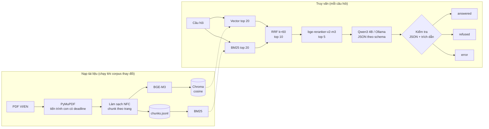

# On-Premise RAG Assistant cho tài liệu Kỹ thuật & HSE

Trợ lý hỏi đáp chạy hoàn toàn trên máy cục bộ. Hệ thống đọc tài liệu PDF tiếng Việt và tiếng Anh, tìm đoạn liên
quan bằng tìm kiếm lai (ngữ nghĩa + từ khóa) có xếp hạng lại, rồi trả lời từng ý kèm trang nguồn để đối chiếu.
Không gọi API bên ngoài: sau bước tải model một lần, cả nạp tài liệu lẫn truy vấn đều chạy không cần Internet.


> Dự án portfolio cho một người dùng trên một máy. Chưa triển khai cho doanh nghiệp và không phải công cụ tư vấn an toàn.

## Tóm tắt nhanh

| | |
| --- | --- |
| **Dữ liệu** | 19 PDF, 568 trang (555 trang có text), 812 đoạn; 7 văn bản tiếng Việt, 12 tài liệu tiếng Anh |
| **Truy xuất** | Bằng chứng đúng đứng hạng 1 ở **79,4%** câu hỏi test (vector thuần: 41,2%); MRR@5 **0,848** (từ 0,591) |
| **Câu trả lời** | 31–32/34 câu đúng ở cả ba chế độ; 0/40 lỗi hệ thống; 5/6 câu ngoài tài liệu được từ chối đúng |
| **Tốc độ** | Khoảng **3 giây** mỗi câu (p50, model đã nạp) trên laptop RTX 5060 8 GB |
| **Kiểm thử** | 101 unit test, 13 integration test với model thật, 4 test chạy offline trên Docker Compose |

Mọi con số ở trên được tính lại được từ kết quả gốc bằng `python -m eval.run_eval score`; phương pháp và giới hạn
nằm ở mục [Đánh giá](#đánh-giá).

## Hệ thống làm gì

- **Trả lời có nguồn theo từng ý.** Mỗi khẳng định đi kèm ID nguồn, ánh xạ tới file, số trang PDF và đoạn trích.
- **Từ chối khi không có bằng chứng.** Câu hỏi ngoài kho tài liệu nhận thông báo "không tìm thấy", không phải câu
  trả lời suy đoán.
- **Hỏi tiếng Việt, tìm được tài liệu tiếng Anh** nhờ embedding đa ngôn ngữ.
- **Bắt được mã hiệu** như `QCVN 25:2015/BLĐTBXH`, `TCVN 4244:2005`, `29 CFR 1910.147` nhờ nhánh từ khóa BM25.
- **Ba chế độ truy xuất** dùng chung một pipeline để so sánh công bằng: chỉ vector, lai, lai có xếp hạng lại.

## Kiến trúc



| Thành phần | Lựa chọn | Ghi chú |
| --- | --- | --- |
| LLM | `qwen3:4b-q4_K_M` qua Ollama | 100% trên GPU, khoảng 4 GB VRAM với context 8192 |
| Embedding | `BAAI/bge-m3` | CPU, đa ngôn ngữ |
| Reranker | `BAAI/bge-reranker-v2-m3` | CPU mặc định; GPU fp16 tùy chọn |
| Lưu trữ | ChromaDB + JSONL + `rank_bm25` | JSONL là bản gốc, Chroma chỉ giữ vector |
| Giao diện | Streamlit | |
| Đóng gói | Docker Compose | Runtime trên mạng nội bộ, không có đường ra Internet |

Pipeline được viết tay trên API của từng thư viện, không dùng framework RAG, để mỗi bước đều đọc và kiểm thử được.

## Quyết định thiết kế

**Lỗi không bao giờ được hiển thị như câu trả lời.** Một truy vấn kết thúc ở đúng một trong ba trạng thái. JSON
sai, trích dẫn không hợp lệ, timeout hay output bị cắt đều là `error` với mã riêng, tách khỏi `refused` (không đủ
bằng chứng). Nhờ vậy số liệu "từ chối đúng" không bị lỗi hệ thống làm đẹp lên.

**Trích dẫn bị ràng buộc bằng schema.** Output của model bị ép theo JSON schema mà danh sách ID nguồn hợp lệ được
sinh riêng cho từng câu hỏi. Model không thể trích một nguồn không nằm trong ngữ cảnh.

**Prompt quá dài bị từ chối, không bị cắt ngầm.** Mặc định Ollama âm thầm cắt prompt vượt context và vẫn trả 200.
Hệ thống gửi `truncate: false` để server báo lỗi rõ ràng; số token đếm cục bộ khớp tuyệt đối với
`prompt_eval_count` trong các phép thử, kể cả với tiếng Việt và mã hiệu.

**Index theo generation, đổi con trỏ nguyên tử.** Mỗi lần ingest dựng một bản index hoàn chỉnh trong thư mục
riêng, kiểm tra cả hai nhánh tìm kiếm rồi mới đổi con trỏ. Ingest lỗi hoặc bị ngắt không ảnh hưởng bản đang phục
vụ; ingest lại cùng dữ liệu cho ra cùng một ID, trên máy thật lẫn trong container.

**Đánh giá tách khỏi model.** Mỗi lượt chạy lưu ảnh chụp câu hỏi, đáp án, toàn văn các đoạn đã truy xuất và hash
của output. Bước chấm điểm không cần model hay index, và từ chối lượt chạy bị sửa sau khi tạo.

**Offline là thứ được kiểm chứng.** Trong Docker Compose, hai container giữ dữ liệu và model chỉ nằm trên mạng
`internal`. Test tự động xác nhận chúng không ra được Internet trong khi giao diện vẫn mở được ở `127.0.0.1`.

## Đánh giá

Bộ câu hỏi gồm 60 câu, mỗi câu có đáp án kèm đoạn bằng chứng nguyên văn và số trang: **20 câu dev** để tinh
chỉnh, **40 câu test** chỉ chạy sau khi cấu hình đã chốt. Bốn nhóm: tra số liệu, câu có mã hiệu, hỏi chéo ngôn
ngữ, và câu ngoài tài liệu.

| Chỉ số trên 40 câu test | vector | hybrid | hybrid + rerank |
| --- | --- | --- | --- |
| Evidence Hit@1 | 14/34 (41,2%) | 18/34 (52,9%) | **27/34 (79,4%)** |
| Evidence Hit@5 | 28/34 (82,4%) | 29/34 (85,3%) | **31/34 (91,2%)** |
| MRR@5 | 0,591 | 0,666 | **0,848** |
| Answer accuracy¹ | 31/34 (91,2%) | 32/34 (94,1%) | 31/34 (91,2%) |
| Từ chối đúng câu ngoài tài liệu | 5/6 | 5/6 | 5/6 |
| Lỗi hệ thống | 0/40 | 0/40 | 0/40 |
| Độ trễ p50 / p95 | 2,8s / 3,8s | 2,8s / 4,2s | 3,0s / 4,2s² |

¹ Chấm tạm thời bằng cách đối chiếu câu trả lời với đáp án, chưa được người chấm độc lập rà lại. Citation
precision và coverage chưa chấm.
² Reranker trên GPU. Trên CPU là 9,7s / 11,4s, với thứ tự top 5 giống hệt trên cả 40 câu.

**Evidence Hit@k** nghĩa là đoạn bằng chứng nguyên văn nằm trong k đoạn đầu được truy xuất, đúng tài liệu và đúng
trang. Cùng trang nhưng thiếu đoạn bằng chứng không được tính.

Cách đọc kết quả:

- **Tìm kiếm lai và reranker cải thiện rõ thứ hạng bằng chứng**: tỷ lệ bằng chứng đúng đứng đầu tăng gần gấp đôi.
- **Độ chính xác câu trả lời không tăng theo.** Cả ba chế độ sai 2–3 câu, mỗi chế độ sai câu khác nhau. Với 34
  câu, một câu là 2,94 điểm phần trăm; chênh lệch này không có ý nghĩa thống kê.
- **Điểm yếu chính nằm ở khâu sinh câu trả lời**: model 4B đôi khi kèm thêm một ý đúng nhưng lạc đề từ nguồn
  khác. Đã thử bốn hướng sửa (quy tắc prompt, giảm ngữ cảnh, đổi bố cục prompt, model 8B); không hướng nào cải
  thiện ròng nên cấu hình giữ nguyên. Chi tiết ở [`docs/limitations.md`](docs/limitations.md).

Máy đo: Intel Core Ultra 9 275HX, 32 GB RAM, RTX 5060 Laptop 8 GB. RAM đỉnh của ứng dụng khoảng 4 GB.
Báo cáo từng lượt chạy và bảng so sánh theo từng câu: [`docs/reports/`](docs/reports/).
Rubric và quy trình: [`docs/evaluation.md`](docs/evaluation.md).

## Giao diện


Nguồn được trích dẫn có số tô màu; bấm vào để xem đoạn trích. Câu hỏi ngoài tài liệu và lỗi hệ thống hiện thành
thẻ riêng, không lẫn với câu trả lời.

## Chạy thử

Cần Python 3.11, [uv](https://docs.astral.sh/uv/), [Ollama](https://ollama.com) và khoảng 8 GB dung lượng cho model.

```bash
# 1. Môi trường và model (cần Internet, làm một lần)
uv venv --python 3.11
uv pip install --python .venv/bin/python --torch-backend cpu -r requirements-dev.txt
ollama pull qwen3:4b-q4_K_M
env PYTHONPATH=. .venv/bin/python scripts/bootstrap-models.py

# 2. Từ đây không cần Internet
export HF_HUB_OFFLINE=1 TRANSFORMERS_OFFLINE=1
.venv/bin/python -m src.ingest
.venv/bin/python -m src.pipeline --question "Thời hạn kiểm định định kỳ của cần trục tự hành là bao lâu?"
.venv/bin/python -m streamlit run src/app.py --server.address=127.0.0.1
```

PDF không nằm trong repo. Danh sách URL và checksum SHA-256 ở [`data/sources.jsonl`](data/sources.jsonl); tải về
`data/raw/` theo đúng tên file. Ingest bỏ qua file có checksum không khớp.

Chạy bằng Docker Compose ở chế độ offline, hoặc đưa reranker lên GPU: xem [`docs/setup.md`](docs/setup.md).

## Cấu trúc mã nguồn

```
src/
  config.py        cấu hình từ biến môi trường, có kiểm tra giá trị
  chunking.py      chia đoạn theo trang, ưu tiên ranh giới câu
  pdf_extract.py   trích text PDF trong tiến trình con
  ingest.py        dựng và công bố generation index
  retriever.py     vector, BM25, RRF, rerank
  generator.py     prompt, ngân sách token, gọi Ollama, kiểm tra trích dẫn
  pipeline.py      ghép truy xuất và sinh câu trả lời; CLI
  app.py           giao diện Streamlit
eval/
  questions.jsonl  60 câu hỏi kèm đáp án và bằng chứng
  run_eval.py      generate, template, score, compare
tests/             unit, integration với model thật, offline trên Compose
docs/              setup, nguồn dữ liệu, đánh giá, giới hạn, báo cáo
```

Chạy test: `.venv/bin/python -m pytest -m "not integration"`.

## Giới hạn

- Chỉ đọc PDF có lớp text; chưa có OCR, bảng biểu bị đọc thành văn bản liền.
- Một người dùng, một câu hỏi tại một thời điểm; chưa có phân quyền, nhật ký kiểm toán hay nhớ hội thoại.
- Hệ thống bảo đảm ID trích dẫn tồn tại trong ngữ cảnh; việc đoạn trích có thật sự hỗ trợ khẳng định hay không
  phải chấm bằng người.
- Chưa chặn được prompt injection từ nội dung tài liệu: chỉ nên nạp tài liệu tin cậy.
- Kho tài liệu có văn bản đã được sửa đổi hoặc thay thế; câu trả lời phản ánh bản PDF trong kho, không phải hiệu
  lực pháp lý hiện hành.
- PyMuPDF theo giấy phép AGPL-3.0 hoặc thương mại; triển khai nội bộ dạng đóng cần giấy phép thương mại hoặc đổi
  thư viện.

Danh sách đầy đủ: [`docs/limitations.md`](docs/limitations.md).

## Nếu triển khai cho tổ chức

Những phần còn thiếu để đi từ bản demo một máy tới hệ thống dùng chung: phân quyền truy cập theo phòng ban, quy
trình phê duyệt và theo dõi hiệu lực tài liệu nguồn, cập nhật corpus tự động, nhật ký câu hỏi phục vụ kiểm toán,
máy chủ GPU nội bộ, và giám sát chất lượng định kỳ bằng bộ câu hỏi chuẩn.

## Tài liệu

- [`docs/setup.md`](docs/setup.md): cài đặt, Docker Compose, cấu hình, mã lỗi
- [`docs/sources.md`](docs/sources.md): nguồn tài liệu và điều kiện sử dụng
- [`docs/evaluation.md`](docs/evaluation.md): bộ câu hỏi, rubric, quy trình
- [`docs/limitations.md`](docs/limitations.md): giới hạn hiện tại
