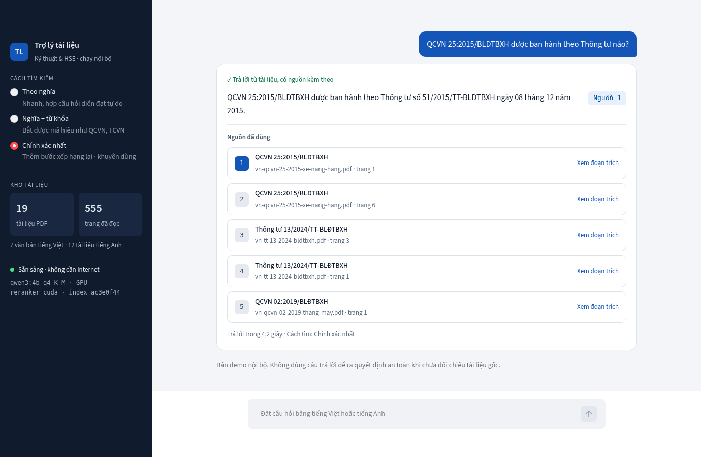
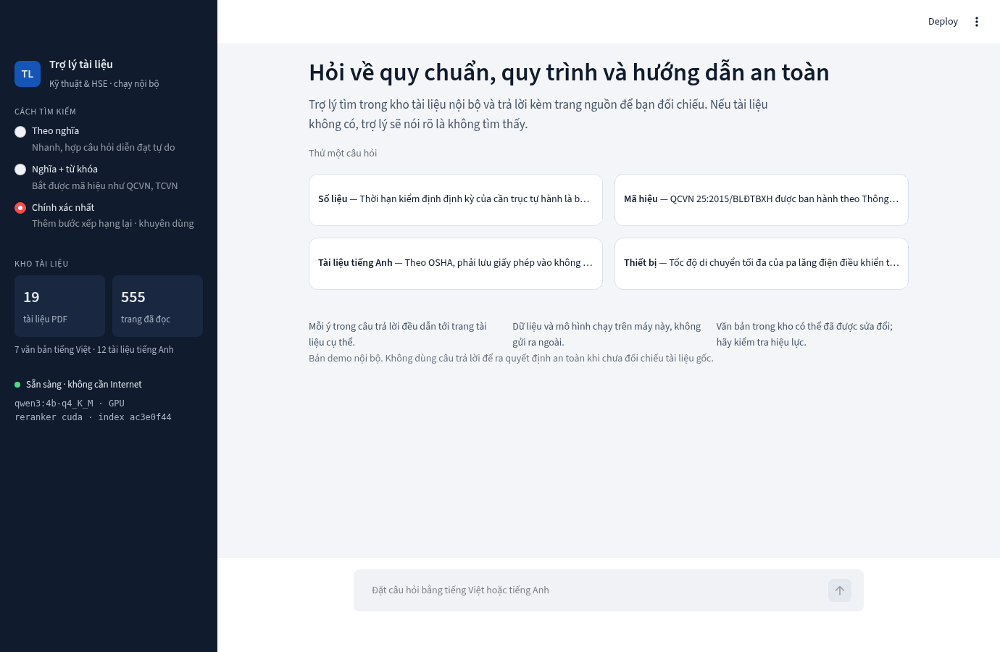

# On-Premise RAG Assistant for Technical & HSE Documents

A question-answering assistant that runs entirely on a local machine. It reads Vietnamese and English PDF
documents, finds the relevant passages with hybrid search (semantic + keyword) and reranking, and answers claim by
claim with the source page for each one. It calls no external API: after a one-time model download, both ingestion
and querying work without Internet access.



> A single-user, single-machine portfolio project. It has not been deployed in an organisation and is not a safety advisory tool.

## At a glance

| | |
| --- | --- |
| **Corpus** | 19 PDFs, 568 pages (555 with usable text), 812 chunks; 7 Vietnamese regulations, 12 English documents |
| **Retrieval** | The correct evidence ranks first for **79.4%** of test questions (vector only: 41.2%); MRR@5 **0.848** (from 0.591) |
| **Answers** | 31–32 of 34 correct in all three modes; 0/40 system errors; 5/6 out-of-corpus questions correctly refused |
| **Speed** | About **3 seconds** per question (p50, models loaded) on an RTX 5060 8 GB laptop |
| **Tests** | 101 unit tests, 13 integration tests with real models, 4 offline tests on Docker Compose |

Every number above can be recomputed from the raw results with `python -m eval.run_eval score`; method and limits
are in [Evaluation](#evaluation).

## What it does

- **Answers with a source for every claim.** Each claim carries source IDs that map to a file, a PDF page and the passage text.
- **Refuses when there is no evidence.** A question outside the corpus gets a "not found" message, not a guess.
- **Vietnamese questions find English documents**, thanks to a multilingual embedding model.
- **Catches identifiers** such as `QCVN 25:2015/BLĐTBXH`, `TCVN 4244:2005` or `29 CFR 1910.147` through the BM25 keyword branch.
- **Three retrieval modes** share one pipeline so they can be compared fairly: vector only, hybrid, hybrid with reranking.

## Architecture


| Component | Choice | Notes |
| --- | --- | --- |
| LLM | `qwen3:4b-q4_K_M` via Ollama | 100% on GPU, about 4 GB VRAM at an 8192-token context |
| Embedding | `BAAI/bge-m3` | CPU, multilingual |
| Reranker | `BAAI/bge-reranker-v2-m3` | CPU by default; optional GPU fp16 |
| Storage | ChromaDB + JSONL + `rank_bm25` | JSONL is the canonical text, Chroma holds vectors only |
| UI | Streamlit | |
| Packaging | Docker Compose | Runtime on an internal network with no route to the Internet |

The pipeline is hand-written on each library's own API, with no RAG framework, so every step can be read and tested.

## Design decisions

**An error is never shown as an answer.** A query ends in exactly one of three states. Malformed JSON, an invalid
citation, a timeout or truncated output is an `error` with its own code, kept apart from `refused` (not enough
evidence). System failures therefore cannot inflate the "correct refusal" figure.

**Citations are constrained by the schema.** Model output is forced into a JSON schema whose list of valid source
IDs is generated per question. The model cannot cite a source that is not in its context.

**An over-long prompt is rejected, not silently cut.** By default Ollama truncates a prompt that exceeds the
context and still returns 200. This system sends `truncate: false` so the server fails loudly; the locally counted
token total matched Ollama's `prompt_eval_count` exactly in every probe, including Vietnamese text and identifiers.

**Index generations with an atomic pointer swap.** Each ingest builds a complete index in its own directory,
probes both search branches, and only then switches the pointer. A failed or interrupted ingest leaves the serving
index untouched; re-ingesting the same data yields the same ID, natively and inside the container.

**Scoring is independent of the models.** Each run stores a snapshot of the questions and gold answers, the full
text of the retrieved passages and a hash of every output. Scoring needs neither models nor an index, and refuses
a run that was edited after it was produced.

**Offline is tested, not assumed.** In Docker Compose the two containers that hold data and models sit only on an
`internal` network. An automated test confirms they cannot reach the Internet while the UI stays reachable on
`127.0.0.1`.

## Evaluation

The question set has 60 questions, each with a gold answer, a verbatim evidence span and its page: **20 dev
questions** for tuning and **40 test questions** run only after the configuration was frozen. Four groups: fact
lookups, questions that hinge on an identifier, cross-language questions, and questions outside the corpus.

| Metric on the 40 test questions | vector | hybrid | hybrid + rerank |
| --- | --- | --- | --- |
| Evidence Hit@1 | 14/34 (41.2%) | 18/34 (52.9%) | **27/34 (79.4%)** |
| Evidence Hit@5 | 28/34 (82.4%) | 29/34 (85.3%) | **31/34 (91.2%)** |
| MRR@5 | 0.591 | 0.666 | **0.848** |
| Answer accuracy¹ | 31/34 (91.2%) | 32/34 (94.1%) | 31/34 (91.2%) |
| Correct refusal of out-of-corpus questions | 5/6 | 5/6 | 5/6 |
| System errors | 0/40 | 0/40 | 0/40 |
| Latency p50 / p95 | 2.8s / 3.8s | 2.8s / 4.2s | 3.0s / 4.2s² |

¹ Provisional grading by comparing each answer with the gold answer; not yet reviewed by an independent grader.
Citation precision and coverage have not been graded.
² Reranker on GPU. On CPU it is 9.7s / 11.4s, with an identical top-5 order on all 40 questions.

**Evidence Hit@k** means the verbatim evidence span is inside one of the first k retrieved chunks, from the right
document and page. The right page without the span does not count.

Reading the results:

- **Hybrid search and reranking clearly improve evidence ranking**: the share of questions with the correct
  evidence in first place nearly doubles.
- **Answer accuracy does not follow.** All three modes miss 2–3 questions, and each mode misses different ones.
  With 34 questions, one question is 2.94 percentage points; the difference is not statistically meaningful.
- **The main weakness is in generation**: the 4B model sometimes adds a true but off-topic claim taken from another
  source. Four fixes were tried (a prompt rule, less context, a different prompt layout, an 8B model); none was a
  net improvement, so the defaults are unchanged. Details in [`docs/limitations.md`](docs/limitations.md).

Test machine: Intel Core Ultra 9 275HX, 32 GB RAM, RTX 5060 Laptop 8 GB. Peak application RAM is about 4 GB.
Per-run reports and a per-question comparison: [`docs/reports/`](docs/reports/).
Rubric and procedure: [`docs/evaluation.md`](docs/evaluation.md).

## Interface



The interface is in Vietnamese. Cited sources have a filled number; click one to read the passage. Out-of-corpus
questions and system errors appear as separate cards and are never mixed with answers.

## Quick start

Requires Python 3.11, [uv](https://docs.astral.sh/uv/), [Ollama](https://ollama.com) and about 8 GB of disk for models.

```bash
# 1. Environment and models (needs Internet, once)
uv venv --python 3.11
uv pip install --python .venv/bin/python --torch-backend cpu -r requirements-dev.txt
ollama pull qwen3:4b-q4_K_M
env PYTHONPATH=. .venv/bin/python scripts/bootstrap-models.py

# 2. No Internet needed from here on
export HF_HUB_OFFLINE=1 TRANSFORMERS_OFFLINE=1
.venv/bin/python -m src.ingest
.venv/bin/python -m src.pipeline --question "Thời hạn kiểm định định kỳ của cần trục tự hành là bao lâu?"
.venv/bin/python -m streamlit run src/app.py --server.address=127.0.0.1
```

The PDFs are not in the repository. URLs and SHA-256 checksums are listed in
[`data/sources.jsonl`](data/sources.jsonl); download them into `data/raw/` under the listed file names. Ingest
skips any file whose checksum does not match.

For the offline Docker Compose runtime, or to move the reranker to the GPU, see [`docs/setup.md`](docs/setup.md).

## Repository layout

```
src/
  config.py        settings from environment variables, validated
  chunking.py      page-bounded chunks that prefer sentence boundaries
  pdf_extract.py   PDF text extraction in a child process
  ingest.py        builds and publishes an index generation
  retriever.py     vector, BM25, RRF, rerank
  generator.py     prompt, token budget, Ollama call, citation validation
  pipeline.py      retrieval + generation; CLI
  app.py           Streamlit UI
eval/
  questions.jsonl  60 questions with gold answers and evidence
  run_eval.py      generate, template, score, compare
tests/             unit, real-model integration, offline Compose
docs/              setup, sources, evaluation, limitations, reports
```

Run the tests: `.venv/bin/python -m pytest -m "not integration"`.

## Limitations

- Reads only PDFs with a text layer; no OCR, and tables are read as flowing text.
- One user, one question at a time; no access control, audit log or conversation memory.
- The system guarantees that a cited ID exists in the context; whether the passage really supports the claim has
  to be graded by a person.
- Prompt injection from document content is not blocked: ingest trusted documents only.
- The corpus contains regulations that have since been amended or replaced; an answer reflects the PDF in the
  corpus, not the law currently in force.
- PyMuPDF is licensed under AGPL-3.0 or a commercial licence; a closed internal deployment needs the commercial
  licence or a different parser.

Full list: [`docs/limitations.md`](docs/limitations.md).

## Towards an organisation-wide deployment

What is missing between this single-machine demo and a shared system: access control by department, an approval
and validity-tracking process for source documents, automatic corpus updates, a question log for audit, an
internal GPU server, and periodic quality monitoring against a standard question set.

## Documentation

- [`docs/setup.md`](docs/setup.md): installation, Docker Compose, configuration, error codes
- [`docs/sources.md`](docs/sources.md): document sources and terms of use
- [`docs/evaluation.md`](docs/evaluation.md): question set, rubric, procedure
- [`docs/limitations.md`](docs/limitations.md): current limitations
